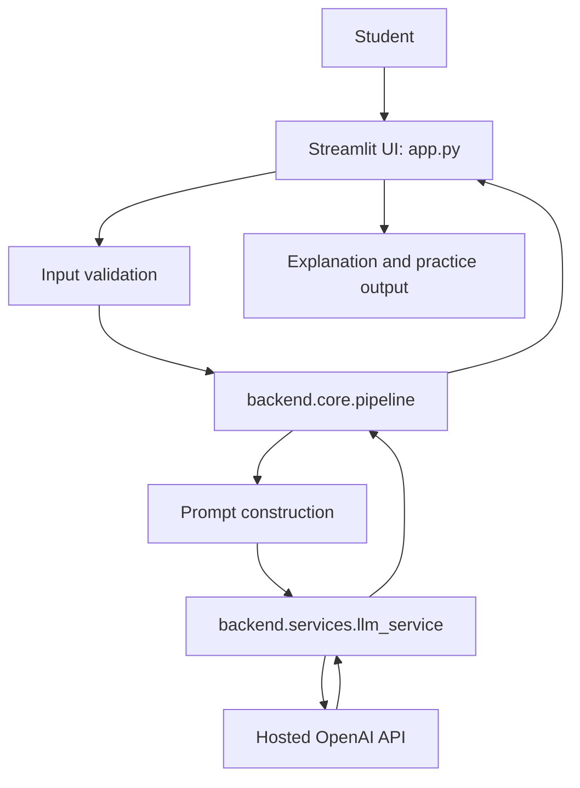

# DoubtBuster — System Design

## Architecture

## Request flow
1. Student selects a subject, topic, difficulty, and learning mode.
2. Streamlit gathers the question, optional text file, and optional attempt.
3. Validators reject empty or oversized input.
4. The pipeline builds instructions appropriate to the selected mode.
5. The LLM service calls the configured hosted model with a timeout and retries.
6. The UI displays the response and a reminder to verify important information.

## Stack
- Frontend: Streamlit
- Backend modules: Python
- LLM: OpenAI API (configurable model name)
- Math library available for future deterministic math helpers: SymPy
- Data analysis library available for future progress analytics: Pandas
- Testing: pytest
- Hosting: Streamlit Community Cloud

## Security and privacy
- Load credentials from `.env` locally or Streamlit Cloud secrets.
- Ignore `.env` and `.streamlit/secrets.toml` in Git.
- Do not upload private course material or personal student records.
- The starter version does not persist student progress to a database.
- Do not execute user-supplied code; code execution would require a separate secure sandbox.

## Known limitations
Responses can be incorrect. The application does not independently execute code, verify every calculation, or provide RAG-based course citations.
